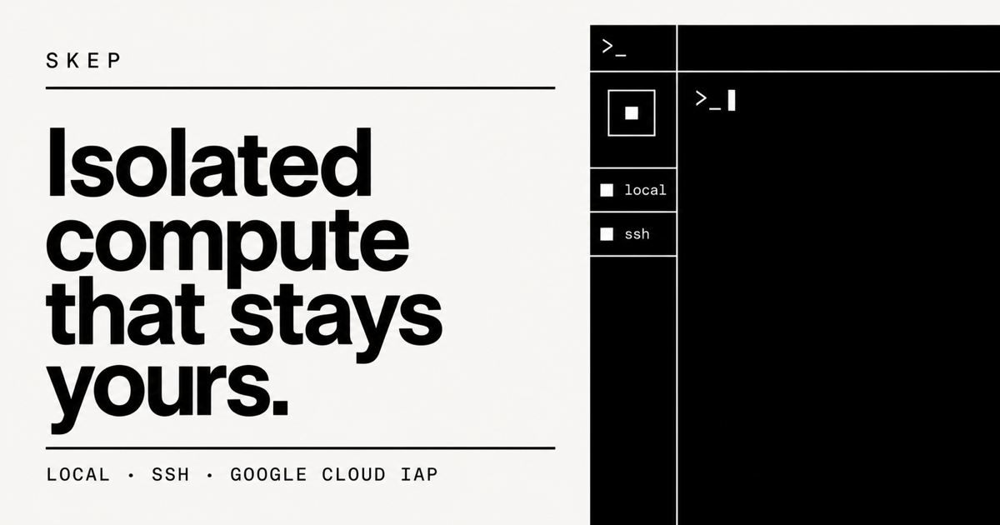

# Skep

[](https://github.com/storozhenko98/skep/actions/workflows/ci.yml)
[](LICENSE)
[](https://skep-compute.vercel.app/download)

Skep gives every coding agent its own persistent Linux microVM. Each workspace
has a separate filesystem, Docker daemon, databases, ports, and machine state,
so parallel tasks cannot collide through shared development infrastructure.

The native macOS app runs workspaces on an Apple Silicon Mac or a Linux VM you
already control. Remote hosts connect through the user's existing OpenSSH or
Google Cloud IAP setup. Both routes use the same small Rust control service and
[Microsandbox](https://github.com/superradcompany/microsandbox).

**Beta:** [product site](https://skep-compute.vercel.app) ·
[download the current Apple Silicon build](https://skep-compute.vercel.app/download)



> **Open-source beta:** the native local transport, SSH and IAP transports,
> daemon protocol, host installation and audit, builder/template/workspace
> lifecycle, reboot reconciliation, and embedded Ghostty terminal are working.
> Local workspaces have completed the complete create, customize, publish,
> launch, reconnect, stop/start, autostart, and guarded-cleanup workflow. Remote
> workspaces require an Ubuntu host that exposes working KVM support.

## Try it

The shortest path needs only an Apple Silicon Mac running macOS 14 or newer:

1. [Download the signed DMG](https://skep-compute.vercel.app/download), open it,
   and drag Skep to Applications.
2. Select **This Mac** and let Skep install its user-owned local runtime. This
   does not require an account, SSH, or an administrator install.
3. Create a builder, install your project and preferred CLI agent, and publish
   the builder as a reusable template.
4. Launch one persistent workspace per task. Each workspace receives its own
   Linux filesystem and Docker environment.

## What is here

- A SwiftUI macOS 14+ application with a first-class **This Mac** provider plus
  regular SSH and Google Cloud IAP hosts.
- User-owned local runtime installation under Application Support, including a
  checksum-pinned native Microsandbox download and a private Unix socket.
  MicroVM state lives under the deliberately short `~/.skep/msb` path so
  Microsandbox agent sockets stay within macOS's Unix-socket path limit.
- Raw SSH/IAP host preflight plus guided installation, repair, and removal of
  the Linux host service.
- A native Metal terminal embedded from `GhosttyKit`, pinned to Ghostty commit
  `f9b2ad8dbed93e0b8cdd6320d8f5a46ba15c5bc8`.
- A versioned, newline-delimited JSON protocol transported by
  `ssh -T <host> sudo -n /usr/local/bin/skepctl bridge`.
- A Rust `skepd` systemd service that listens only on a host-local Unix socket.
- Real KVM capability checks, including opening `/dev/kvm` and issuing
  `KVM_GET_API_VERSION`.
- Builder creation and Docker/tool bootstrap, snapshot publication and
  verification/deletion, self-contained template export, and workspace
  create/start/stop/autostart/destroy operations.
- Generation checks on destructive or state-changing workspace operations.
- A dedicated disk-backed named volume for `/var/lib/docker` and explicit
  CPU, RAM, root-disk, `/tmp`, DNS, and network settings.

Skep uses four product nouns:

| Term | Meaning |
| --- | --- |
| **Host** | This Mac or a persistent Linux VM. It runs `skepd` and Microsandbox. |
| **Builder** | An editable microVM used to prepare a reusable environment. |
| **Template** | A verified Microsandbox disk snapshot plus its launch profile. |
| **Workspace** | A persistent microVM created from a template. |

## Why a microVM?

Skep is infrastructure for coding agents, not another agent UI:

| Approach | What remains shared | What Skep changes |
| --- | --- | --- |
| Git branches and worktrees | Host packages, ports, processes, Docker, databases, and credentials | Every task runs in a separate Linux machine. |
| Dev Containers | The container runtime and host kernel; often the host Docker daemon | Every workspace has its own kernel boundary and Docker daemon. |
| General-purpose VM tools | Provisioning exists, but the builder/template/workspace workflow is manual | Skep makes persistent agent workspaces the product model and navigation. |
| Agent orchestrators | They commonly manage sessions or checkouts rather than the underlying machine | Skep does not wrap the agent; it isolates the environment where any CLI agent runs. |

Skep is deliberately compatible with terminal-based tools such as Codex,
Claude Code, and OpenCode. Install the tools you want in a builder, capture a
template, and reuse that environment without giving Skep access to an agent
account.

## Architecture

```text
macOS                                               Optional Linux host
┌──────────────────────────────────────┐           ┌───────────────────────────────┐
│ Skep.app (SwiftUI + AppKit)           │   SSH     │ systemd: skepd (Rust)         │
│                                      ├──────────►│ /run/skep/skepd.sock          │
│ This Mac ─► local socket ─► skepd    │           │ skepctl bridge / shell         │
│                  │                   │           │         │                     │
│                  ▼                   │           │         ▼                     │
│ Apple Silicon Microsandbox microVMs  │           │ Microsandbox/KVM microVMs      │
└──────────────────────────────────────┘           └───────────────────────────────┘
```

No daemon TCP port is exposed. A dedicated `skep` operator group receives
passwordless access to only the bridge and workspace-shell commands; those
commands enter the root-owned control plane through `sudo -n`. OpenSSH handles authentication, host-key
checking, keys, agents, jump hosts, and IAP. Host definitions contain
connection metadata only; Skep does not store SSH passwords or private keys.

See [docs/architecture.md](docs/architecture.md) for component and lifecycle
details and [docs/research.md](docs/research.md) for the source investigation.

## Build the Mac app

Requirements:

- Apple Silicon Mac running macOS 14 or newer;
- Xcode 16 command-line tools;
- Swift 6;
- Zig 0.16 or newer;
- Rust with the `x86_64-unknown-linux-gnu` target installed;
- `ssh`, and `gcloud` when using Google Cloud IAP.

Build the pinned native Ghostty framework, compile the local helpers,
cross-compile the Linux host installer payload, test the Swift packages, and
package a local ad-hoc-signed application:

```sh
./scripts/build-ghostty-framework.sh
cd apps/macos && swift test && cd ../..
./scripts/package-macos.sh
open artifacts/Skep.app
```

The generated Ghostty XCFramework, Swift build products, and `artifacts/` are
intentionally ignored by Git. The package is currently native arm64. The
production download is Developer ID signed and notarized; running
`package-macos.sh` without a signing identity intentionally creates only a
local ad-hoc build.

To build the complete beta release, including the signed Sparkle feed
and drag-to-Applications DMG:

```sh
./scripts/package-release.sh
```

The app checks the production appcast automatically. A packaged client also
compares the bundled `skepctl` and `skepd` checksums with every ready remote
host and updates the service over its existing SSH/IAP transport when the host
supports systemd and non-interactive sudo. See
[docs/distribution.md](docs/distribution.md) for versioning, deployment,
Developer ID, notarization, and update-key procedures.

To exercise RPC and a real rendered SSH terminal during tests:

```sh
SKEP_INTEGRATION_HOST=example-host \
SKEP_INTEGRATION_USER=root \
./scripts/package-macos.sh
```

The integration host must already have `skepd`, `skepctl`, and key-based SSH
access configured.

## Prepare a Linux host

The current host target is Ubuntu 24.04 x86-64 with systemd and working KVM.
If the host is itself a VM, its provider must expose nested virtualization.
Before installing anything, verify:

```sh
test -c /dev/kvm
lsmod | grep '^kvm'
```

Skep performs a stronger check through the actual KVM ioctl and reports the
reason in the app. A missing `/dev/kvm` cannot be repaired from inside a cloud
guest; the instance must be reconfigured or recreated on compatible hardware.
See [docs/vm-setup.md](docs/vm-setup.md).

The normal setup path is now in the app: add a reachable host, let Skep run its
read-only preflight, then choose **Install Skep**. Automatic setup requires
Ubuntu 24.04 x86-64, systemd, outbound HTTPS, and non-interactive sudo for the
SSH/IAP login. The packaged app uploads a checksummed Linux payload, installs
the pinned Microsandbox runtime, enables `skepd`, waits for its Unix socket,
and verifies the daemon. **Uninstall, keep data** removes the control binaries
and system service while preserving `/var/lib/skep` and Microsandbox. The
remote-host Overview also has a typed-confirmation **Erase all data** action
that first stops every managed microVM and then permanently removes all
Skep-owned runtime state from the VM without deleting the VM itself.

The following commands remain available for manual setup and diagnostics.

Install the checksum-pinned Microsandbox v0.6.8 runtime into its service-owned
directory:

```sh
sudo ./deploy/install-microsandbox.sh
sudo MSB_HOME=/var/lib/skep/microsandbox \
  /var/lib/skep/microsandbox/bin/msb doctor
```

Build the Rust programs on the Linux host and stage the installer payload:

```sh
cargo build --workspace --release
install -d /tmp/skep-install
install -m 0755 target/release/skepd target/release/skepctl /tmp/skep-install/
install -m 0644 deploy/systemd/skepd.service /tmp/skep-install/
sudo ./deploy/install.sh /tmp/skep-install
```

When installing through `sudo`, the installer adds `SUDO_USER` to the `skep`
operator group. When installing as root for a different SSH/IAP login, name it
explicitly and reconnect after installation so the new group is applied:

```sh
sudo SKEP_OPERATOR=your-login ./deploy/install.sh /tmp/skep-install
```

The installer enables and starts `skepd`, waits for its Unix socket, and sends
a protocol ping. Useful diagnostics are:

```sh
systemctl is-enabled skepd.service
systemctl is-active skepd.service
sudo skepctl call host.info --compact
journalctl -u skepd.service -n 100 --no-pager
```

## Product workflow

The host view has four stable sections: **Overview**, **Builders**,
**Templates**, and **Workspaces**. Overview presents the three-step guide only
until the first workspace exists. The other sections remain the permanent
management surfaces for every resource, including start/stop, terminal,
autostart, export, and guarded deletion. Operations report scoped progress and
refresh their resource lists without navigating back to the top of the host.

1. Select **This Mac**, add a regular SSH host, or add a Google Cloud instance
   reached through IAP.
2. Inspect the host and install its user-owned local runtime or Linux service
   when prompted.
3. Inspect the daemon audit and suggested resource profile.
4. Create a builder from an OCI image.
5. Install Docker and baseline tools, then customize the builder in its
   embedded terminal.
6. Publish a verified, immutable template snapshot.
7. Create one or more workspaces from the template.
8. Connect, stop, restart, toggle reboot autostart, or destroy each workspace.
9. Export a template with its OCI image as a `.tar.zst` archive on the host.

Resource settings are launch configuration, not part of a disk snapshot, so
Skep records and reapplies them. Docker data is kept on a separate ext4 named
volume because Docker `overlay2` cannot safely use Microsandbox's overlay root
as its backing filesystem.

## Current scope

Included now:

- native macOS client;
- native Apple Silicon local provider with install, repair, start, removal, and
  local terminal paths;
- generic SSH and GCloud IAP connections;
- embedded host and workspace terminals;
- one daemon and local state store per host;
- builder, template, export, workspace, and autostart lifecycle;
- KVM, host resource, Microsandbox, IPv4, and IPv6 reporting.

Not included in the current beta:

- GCE instance discovery/creation and cloud-side nested-virtualization checks;
- reconnecting to the same long-running shell/agent process rather than opening
  a fresh SSH shell into the persistent workspace;
- template import, live resize, metrics, port forwarding, and secret injection;
- a Skep-maintained Microsandbox fork/distribution once an upstream patch is
  actually required;
- universal binaries, a stable release channel, and unattended CI release
  publication (Developer ID signing and notarization currently run from the
  release Mac's Keychain);
- AWS support and non-macOS clients.

## Repository layout

```text
apps/macos/               native SwiftUI client and Ghostty adapter
crates/skep-protocol/     shared protocol models and method names
crates/skepd/             Linux daemon and Microsandbox lifecycle
crates/skepctl/           Unix-socket client, SSH bridge, workspace shell
deploy/                   systemd unit and host installers
docs/                     architecture, VM setup, and research
scripts/                  Ghostty build and macOS packaging
website/                  static launch and release distribution site
```

## Privacy and licensing

Skep is licensed under the [Apache License 2.0](LICENSE). Contributions are
accepted under the same license. Third-party components keep their own terms.
The packaged app includes the Ghostty and Sparkle notices; Microsandbox remains
an unmodified, separately installed Apache-2.0 runtime. See
[THIRD_PARTY_NOTICES.md](THIRD_PARTY_NOTICES.md) and
[ACKNOWLEDGMENTS.md](ACKNOWLEDGMENTS.md).

## Contributing and support

Start with [CONTRIBUTING.md](CONTRIBUTING.md) for the development environment,
verification commands, and pull-request expectations. Use
[GitHub Issues](https://github.com/storozhenko98/skep/issues) for bugs and
focused feature requests. Vulnerabilities must be reported privately according
to [SECURITY.md](SECURITY.md). Public release and verification gates are tracked
in [docs/open-source-release.md](docs/open-source-release.md).
