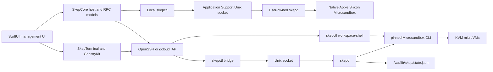
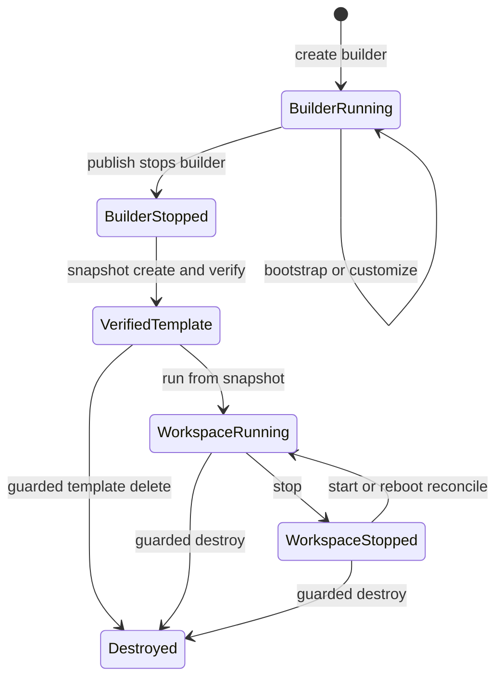

# Skep MVP architecture

## Boundaries

Skep supports two host topologies behind one protocol:

1. **This Mac:** the app installs user-owned helpers under Application Support,
   keeps Microsandbox microVM state under the socket-safe `~/.skep/msb` path,
   starts `skepd` on demand, and reaches it through a private local Unix socket.
2. **Remote Linux:** the app reaches `skepctl` through SSH or Google Cloud IAP;
   the host-local socket and Microsandbox state remain on that Linux machine.

The daemon has no network listener. An authorized `skep` group member invokes
`skepctl bridge` or `skepctl workspace-shell` through a command-specific
passwordless sudo rule. The bridge copies newline-delimited JSON between SSH
stdio and `/run/skep/skepd.sock`. Interactive terminals use a separate
PTY-backed SSH process because terminal data should not be mixed with control
messages.

## Mac client

`SkepCore` stores host records under the user's Application Support directory.
A record contains a hostname, username, port, optional identity-file path, or
the GCloud instance/project/zone tuple. Authentication remains in OpenSSH,
`ssh-agent`, or `gcloud`; secret material is not serialized by Skep.

Each RPC launches a non-interactive SSH command with `BatchMode=yes`, writes
one protocol request, and decodes one response. Host and workspace terminals
are real interactive processes rendered by Ghostty's native AppKit/Metal
surface. The Ghostty dependency is isolated in `SkepTerminal` and pinned by the
framework build script.

Fresh hosts use a separate bootstrap path because `skepctl bridge` cannot run
before `skepctl` exists. The app first executes a read-only shell preflight over
raw SSH/IAP. On a supported host, an explicit install action streams a
checksummed Linux payload to a private temporary directory, installs the pinned
Microsandbox runtime and Skep service through non-interactive sudo, then returns
to the normal bridge protocol. Removal uses the same authenticated transport
and preserves `/var/lib/skep`.

The local provider is a singleton identified as **This Mac**. It is never
serialized with remote host records and cannot be removed from the sidebar.
Setup copies the app's native `skepctl` and `skepd` helpers, downloads the pinned
Apple Silicon Microsandbox archive, verifies its SHA-256 checksum, and starts
the daemon without sudo. Removing the runtime preserves local workspace state
and exports so reinstalling can recover them.

## Remote control plane

`skepd` is a restartable Rust systemd service. It persists a schema-versioned
JSON document atomically and reconciles workspaces whose desired state is
running and whose autostart flag is enabled whenever the daemon starts.

Protocol v1 includes:

- `ping` and `host.info`;
- `builder.create` and `builder.bootstrap`;
- `template.publish`, `template.list`, `template.export`, and `template.delete`;
- `workspace.create`, `workspace.get`, `workspace.list`, `workspace.start`,
  `workspace.stop`, `workspace.setAutostart`, and `workspace.delete`.

State-changing requests may include an expected generation. A stale client
receives a conflict rather than changing a newer object.

## Template lifecycle

A template combines the disk snapshot identity with its resource profile.
CPU/RAM ceilings, root disk, tmpfs, named Docker volume, DNS, and network
policy are launch-time inputs and must be reapplied to every new workspace.

The Docker volume is created as a disk-backed named volume mounted at
`/var/lib/docker`. The baseline bootstrap installs Docker, Git, curl, Git LFS,
and tmux, and creates a small Docker startup helper inside the builder.

## Failure behavior

- KVM is checked before any mutating Microsandbox operation. The daemon opens
  `/dev/kvm` and validates `KVM_GET_API_VERSION`, rather than treating the
  device's existence as sufficient.
- Invalid CPU/RAM relationships and allocations larger than the host are
  rejected before launch.
- Microsandbox stderr is returned as a structured `runtime_error`.
- Workspace deletion uses immutable IDs and generation checks. The Docker
  volume is then removed explicitly.
- Template publication stops the builder, creates the snapshot, and verifies
  it before recording the template.

## Current durability boundary

The workspace and its disk survive terminal disconnects, app exits, and host
daemon restarts. A new terminal currently opens a new `msb ssh` shell; exact
shell-process or coding-agent multiplexing is the next layer, informed by
Beehive but not claimed by this MVP.
